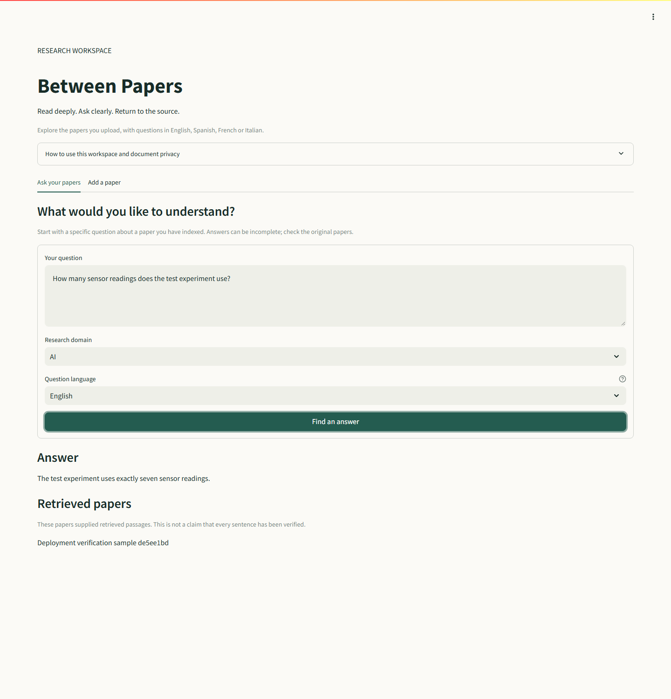
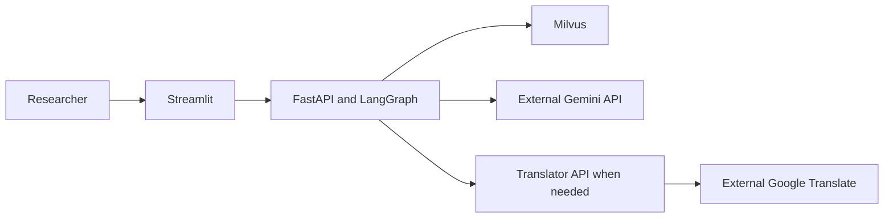

# Between Papers

**Discover connections across research.**

**[Open Between Papers](https://between-papers.onrender.com)** ? hosted on Render free services.
The first request after inactivity can take longer while services wake up.

[](https://github.com/ManeswarSahu11/between-papers/actions/workflows/checks.yml)


A focused workspace for uploading research papers and asking questions about
their contents. Choose a research domain, ask in one of four languages, and
review the paper titles that supplied retrieved context.

[Quick start](docs/SETUP.md) · [Architecture](docs/ARCHITECTURE.md) ·
[Deployment](docs/DEPLOYMENT.md) · [Validation](docs/VALIDATION.md) ·
[Maintainer and attribution](MAINTAINERS.md)

## Workspace preview



Real public deployment capture using a generated verification paper, live Gemini
and Zilliz retrieval. The sample paper was removed after the check; it is not
preloaded content. The phone and tablet images below use deterministic fixtures.
[Phone view](docs/images/phone.png) ? [Tablet view](docs/images/tablet.png)

## What you can do

| Capability | Implemented behavior | Limits |
| --- | --- | --- |
| Add papers | Extract text, split passages, embed and store in Milvus | Text PDFs; no OCR or deduplication |
| Ask questions | Domain-filtered vector retrieval and Gemini generation | Requires configured providers; answers need checking |
| Work across languages | English, Spanish, French, Italian | Translation can fail; retrieval quality is unbenchmarked |
| Review sources | Show titles of retrieved papers | No page citations or verified claim-level attribution |
| Handle failures | Input validation, loading messages, useful errors | No offline answer fallback |

No papers are bundled or automatically indexed. The library is shared across
users of one deployment; it is not a private document vault. There is no account
system, web search, or autonomous literature review.

## How it fits together



The agent validates PDFs, excludes text after detected bibliography headings,
and retrieves passages from the selected AI, Security or Other domain. LangGraph
runs generation on those passages. The prompt asks for evidence-grounded answers;
it does not guarantee correctness. [Detailed flows and boundaries](docs/ARCHITECTURE.md).

## Run locally

Use Python 3.12, a reachable Milvus server, and a Gemini API key. Keep secrets in
ignored local configuration or hosting settings. The translator needs a separate
environment because of its legacy HTTP dependencies.

```sh
python -m venv .venv
# Activate the environment before installing:
# Windows: .venv/Scripts/activate
# macOS/Linux: source .venv/bin/activate
python -m pip install -r agent-service/requirements.txt -r frontend/requirements.txt -r requirements-dev.txt
python -m pytest -q
```

Follow the [setup guide](docs/SETUP.md) to configure and start each service.
Existing Kubernetes and Terraform configurations are retained as an optional
path; they are not evidence of a running deployment or a free hosting plan.
See [deployment requirements](docs/DEPLOYMENT.md).

## Project map

| Directory | Purpose |
| --- | --- |
| `frontend/` | Streamlit reading and question workspace |
| `agent-service/` | PDF ingestion, retrieval and answer API |
| `Docker-NLP/` | Translation API and preserved upstream examples |
| `infra/k8s/` | Optional Kubernetes service manifests |
| `milvus-gke/` | Milvus Helm install into an existing cluster |
| `tests/` | Deterministic API and interface regressions |
| `docs/` | Setup, architecture, deployment and verification |

Maintained by **Maneswar Sahu** (<maneswar.sahu2005@gmail.com>).
Upstream examples and external paper attribution are preserved; see
[provenance and unresolved licensing](MAINTAINERS.md). No new license or exclusive
copyright claim has been invented for this source download.
