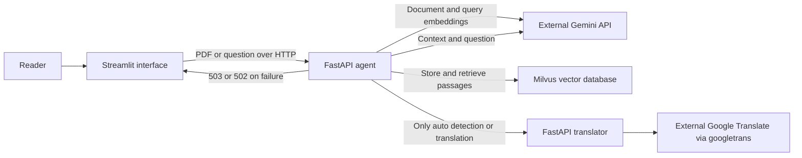
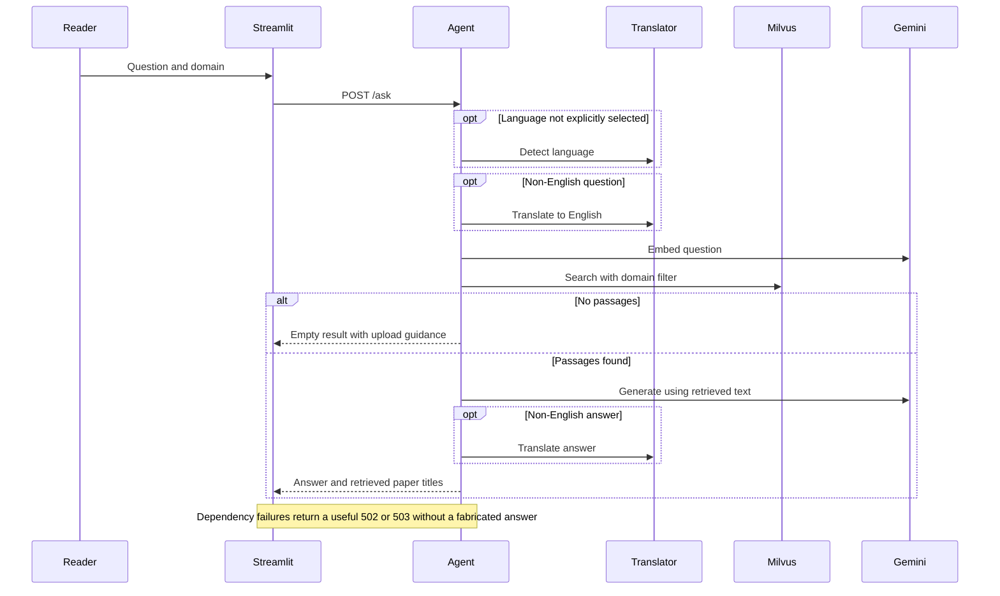
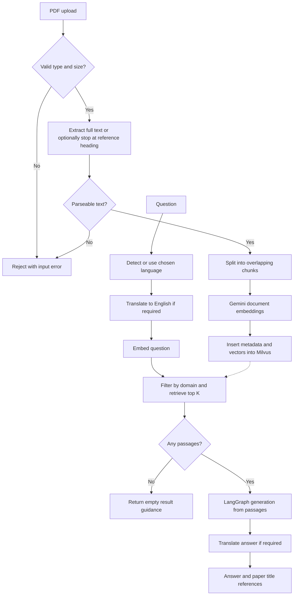

# Architecture

## Service boundaries

## Main request flow

## Core ingestion and retrieval algorithm

LangGraph contains a pass-through retrieval node and a generation node. Retrieval
actually occurs before graph invocation; this is not autonomous web research or
a general tool-selecting agent. Recommendations choose the two most frequent
paper titles among retrieved chunks. Similarity scores are not confidence scores.
References contain document titles, not links, page citations, or verified claim spans.
The legacy API field names `paper_title` and `domain` remain for compatibility.
UI category General documents maps to `Other`; AI & technology maps to `AI`.
The frontend sends `exclude_references=false` by default. Existing API clients
that omit that field keep the original reference-excluding behavior.

All users share one collection. There are no accounts, ownership filters,
delete endpoints, OCR, automatic deduplication, or web search. Repeated uploads
create more chunks. Prompt instructions request context-grounded answers but do
not guarantee factuality or defend against all instructions embedded in papers.

## Session conveniences

Question starters are predefined templates and make no provider call. Successful
responses are stored with the submitted question, category and language in
Streamlit session state (maximum ten). Reopening an entry reads that response
without rerunning retrieval or generation. It is not conversation memory for
the model, an account history or a private document library.

Markdown downloads use the saved request context, so editing an unsubmitted
question does not relabel an old answer. Clearing session history also clears
the displayed answer and question; it does not delete indexed documents.
