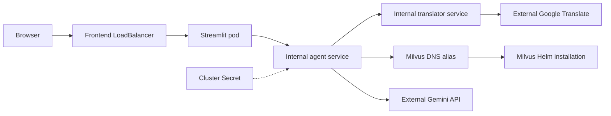

# Deployment

## Free hosting constraints

No cloud resources have been provisioned by this revision. The inherited GKE
manifests and Terraform describe a resource-consuming deployment, not a free
hosting plan. Do not apply them without checking costs in your own account.

The [Render free service documentation](https://render.com/docs/free) describes
idle spin-down and ephemeral storage. Checked 8 November 2026; service and
account limits can change and may differ by region. A persistent Milvus server
is not provided by a free Render web service. Hosting only the interface without
a working agent, credentials and database is not a complete deployment.

A free full deployment needs a separately provisioned compatible vector service,
model API access within the account's free allowance, and hosting capacity for
the Python services. No paid plan is authorized. The original multi-service
architecture is retained rather than replaced with an undisclosed demo fallback.

## Containers

```sh
docker build -t research-agent:local agent-service
docker build -t research-translator:local Docker-NLP
docker build -t research-frontend:local frontend
```

Each Dockerfile starts the service on its declared port (8080, 8000, 8501).
Configure secrets using hosting environment settings. Never bake `.env` into an
image. The frontend image includes its Streamlit theme configuration.

## Existing Kubernetes option



`milvus-gke/` installs Milvus into an **existing** Kubernetes cluster. It does not
create a GKE cluster. Several inherited variables are unused. The chart is not
version-pinned; validate it against the target cluster before applying. The
inherited Attu LoadBalancer is another externally exposed component.

`infra/k8s/` retains namespace `option1` to avoid silently migrating existing
resources. Image references now use local development tags instead of another
person's registry. Build and push images into your own registry, then replace
all three references with immutable image digests before rollout. Local tags are
not a production deployment configuration and may not be reachable by a cluster.
Create the real Secret privately; `secret.example.yaml` contains placeholders.

The APIs support a shared `API_ACCESS_TOKEN` sent through `X-API-Key`. Set the
same strong token on all services before exposing the APIs. It protects service
access, not individual users. There is no request quota or tenant isolation.
Uploaded papers are shared. Liveness `/healthz` confirms only the API process;
`/readyz` initializes provider clients and the Milvus collection but does not
prove a generation call will succeed. Frontend health is `/_stcore/health`.

## Release verification

1. Build each container and check its startup and health endpoint.
2. Verify missing-key and unavailable-database errors without disclosing secrets.
3. Upload a permission-cleared text PDF into a fresh test domain/collection.
4. Ask a question whose answer is in that paper; inspect returned titles and answer.
5. Exercise Spanish, French and Italian translation and provider failure handling.
6. Test the public homepage and core workflow on phone, tablet and desktop.
7. Record the deployment URL, service region, verified commit and known limitations.

No successful deployment should be inferred from configuration files alone.


## Render blueprint (prepared, not deployed)

[`render.yaml`](../render.yaml) declares three Docker web services with `plan: free`
and one generated shared service token. Connect the repository in Render and use
the Blueprint flow. Set private Gemini and Milvus values when prompted. Set
`TRANSLATOR_BASE_URL` on the agent to the translator's public HTTPS URL, and
`AGENT_BASE_URL` on the frontend to the agent's public HTTPS URL. URLs must come
from the actual service creation results, not guessed hostnames.

Three active services share the account's free instance-hour allowance. Idle
spin-down can cause cold starts and timeouts; this architecture is not guaranteed
to run continuously within that allowance. Free memory limits may also be too
small for the agent plus its Python dependencies. Validate actual resource use
before claiming compatibility. Do not upgrade to a paid instance automatically.

The blueprint has been checked locally for YAML syntax and free-plan declarations.
Render-side acceptance, image builds and live workflows require the connected
account, provider credentials and a deployment run.
